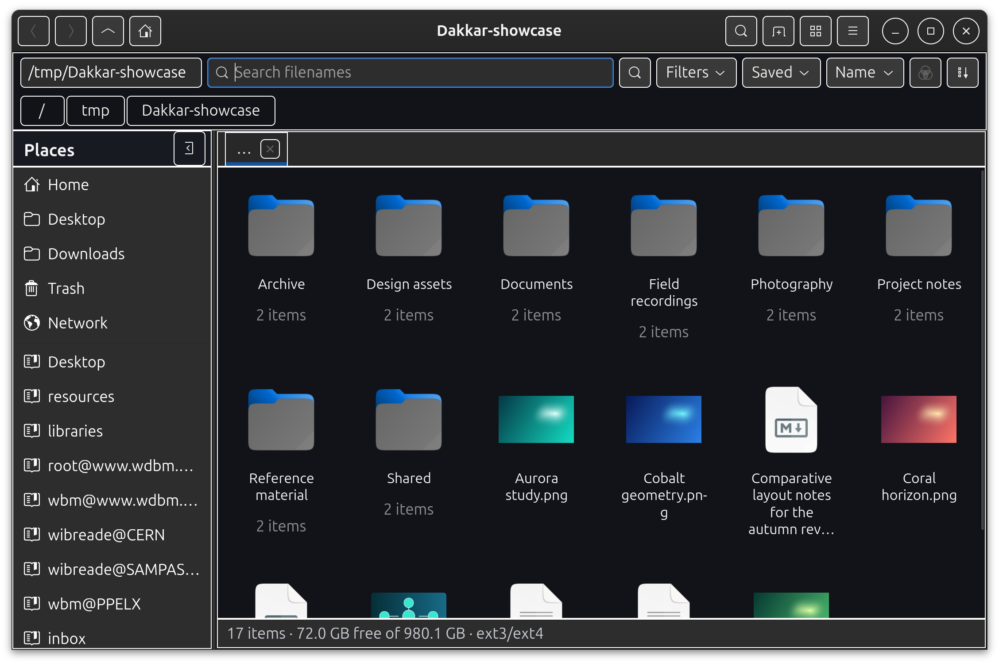

# Dakkar



Dakkar is a Python GNOME file browser with grid, list and expandable-list views, windows, tabs, panes, and optional position and colour ranking visualisations.

## Setup

```Bash
sudo apt install            \
    desktop-file-utils      \
    gir1.2-gtk-4.0          \
    gir1.2-gdkpixbuf-2.0    \
    gir1.2-gnomedesktop-4.0 \
    python3-docopt          \
    python3-gi              \
    python3-setuptools      \
    python3-venv            \
    python3-wheel
```

Optional: Tracker accelerates indexed filename searches. File Roller provides archive creation, extraction and encrypted archives and passcode prompts. GStreamer metadata bindings add audio and video properties.

```Bash
sudo apt install                \
    file-roller                 \
    gir1.2-gstreamer-1.0        \
    gir1.2-gst-plugins-base-1.0 \
    gir1.2-tracker-3.0
```

### Recommended setup

From a source checkout, perform a user installation.

```Bash
./install.sh --user
```

Alternatively, perform a system-wide installation.

```Bash
sudo ./install.sh --system
```

Dependencies are checked, a virtual environment with access to GNOME bindings is created, and the programme is installed without downloading packages. Launcher, desktop entry and icon are also installed. This method is recommended because `pip` does not place desktop integration files at the appropriate user or system locations.

### PyPI setup

The programme can be installed from PyPI. A virtual environment with access to system site packages is required so that PyGObject and GNOME bindings remain visible.

```Bash
python3 -m venv --system-site-packages .venv
source .venv/bin/activate
pip install dakkar
dakkar --version
```

This method does not install the desktop entry or application icon, and the distribution packages listed above are still required.

## Configuration

High-contrast borders are enabled by default (`--high-contrast`) and can be disabled (`--no-high-contrast`). A dark palette with blue selection colour is used by default; the GTK theme and colours can be inherited with `--system-theme`. Colour ranking is disabled by default and can be enabled with `--directory-tint`. Optional indexed filename search can be disabled with `--no-index`.

## Usage

|Cause                         |Effect                                                |
|------------------------------|------------------------------------------------------|
|`Ctrl+F`                      |Search filenames below the displayed directory        |
|`Ctrl+Shift+F`                |Search filenames below Home                           |
|Printable character input     |Search filenames using the selected scope             |
|`Escape` during search        |Clear the search and return to the directory view     |
|`Ctrl+L`                      |Focus the editable location field                     |
|`Alt+Left` / `Alt+Right`      |Navigate back or forward                              |
|Back / Forward keys           |Navigate back or forward                              |
|Mouse buttons 8 / 9           |Navigate back or forward                              |
|Middle mouse button           |Open a directory or place in a new tab, or open a file|
|Drag / `Ctrl`+drag            |Move items to the destination / copy them instead     |
|`Alt+Up` / `Alt+Home`         |Open the parent directory or Home                     |
|`Ctrl+1` / `Ctrl+2` / `Ctrl+3`|Use list, grid or expandable list view                |
|`Ctrl+H`                      |Show or hide hidden files                             |
|`Ctrl+T` / `Ctrl+W`           |Open or close a tab                                   |
|`Ctrl+Shift+T`                |Restore the most recently closed tab                  |
|`F9`                          |Show or hide `Places`                                 |
|`Ctrl+N`                      |Open another window                                   |
|`Ctrl+Shift+N`                |Create a directory                                    |
|`F2`                          |Rename the selected item                              |
|`Ctrl+C`, `Ctrl+X`, `Ctrl+V`  |Copy, cut and paste                                   |
|`Ctrl+D`                      |Duplicate selected items                              |
|`Ctrl+Z` / `Ctrl+Shift+Z`     |Undo or redo a safe session operation                 |
|`Delete` / `Shift+Delete`     |Move to Trash or permanently delete                   |
|`Alt+Return`                  |Show properties                                       |
|`Ctrl+.`                      |Open the displayed local directory in a terminal      |
|`F5` or `Ctrl+R`              |Refresh                                               |
|`F1`                          |Show keyboard shortcuts                               |

## Behaviour

### Places, paths and tabs

GTK bookmark files are read from the GTK 4 and GTK 3 configuration directories. A place can be opened in a new tab with the middle mouse button. The place context menu provides `Open in new tab` and `Open in new pane` when available, `Open in new window` and `Open in terminal`. The button beside the `Places` heading hides the panel; `F9` and `Show or hide Places` restore the previous panel width. Each breadcrumb path button provides the same directory actions.

Two tabbed panes can be displayed side by side. `Open in new pane` creates a second notebook at the right and transfers focus without moving existing tabs. New tabs and window-level navigation target the focused pane. Closing the final pane tab collapses the split. Tab labels use end ellipsisation when space is insufficient, and hovering reveals the full directory name. A tab context menu provides `Duplicate tab`, `Open in new pane` when available, `Open in new window`, `Open in terminal`, `Copy location`, `Refresh` and `Close tab` for the targeted tab.

`Ctrl+Shift+T` restores tabs in most-recently-closed order, including navigation history, pane and tab position, view, ordering, hidden-file state, grid settings, filters and colour-ranking configuration.

### Search and views

Search is restricted to filenames. Printable character input at the directory view is forwarded to `Search filenames`, providing type-ahead search without interfering with editable controls. The first sorted match is selected automatically when results begin to appear; later asynchronous batches do not overwrite a subsequent selection. `Escape` clears the query and returns focus to the directory view. `Filters` restricts loaded items and search matches by MIME family and modified, accessed or created date. Changes are staged until `Apply` is selected; selecting elsewhere closes the panel without applying them. Filters are retained by each tab. Searches can be saved and reopened through `Saved`. Direct global search is restricted to the home directory when the system index service is unavailable.

`Expandable list view` presents native disclosure controls beside directories. Expanding a row loads its immediate children asynchronously, and nested directories may be expanded to arbitrary depth. Several branches can load concurrently and each branch is monitored for external changes. Sorting, filters, selection status, context menus, drag-and-drop and file operations apply to nested rows. Expanded URIs are restored across refreshes and filter changes. Search results remain a flat list until the query is cleared.

Directory loading presents a small initial batch before processing larger batches, while sorting is distributed across GTK main-loop turns. File-monitor and completed-operation updates add, replace or remove only affected items in root and expanded views. Manual refresh preserves the displayed model while a background snapshot is reconciled. Up to ten recently visited directory snapshots are retained by each tab so that Back, Forward and repeat navigation can present cached contents immediately. Thumbnail requests belong to visible cells, prioritise newly visible items, discard obsolete callbacks after scrolling or navigation, and use a bounded in-memory cache.

Newly-opened directories start at the top of each view. The first item is maintained as the scrolling anchor during asynchronous enumeration and layout. Returning directly to a parent with `Back` selects and scrolls to the directory which has just been left after the parent has loaded.

### File operations

Selected files can be dragged between directories or exchanged with applications supporting the GTK file-list transfer type. Dropping over a directory targets that directory; dropping over the view background targets the displayed location. Move is preferred, while holding `Ctrl` requests Copy. Drag operations use the same recursive merge and conflict handling as clipboard operations.

`Paste`, drag-and-drop, `Copy to…` and `Move to…` share recursive conflict handling. Same-named directories may be merged or skipped. A merge descends into both trees and asks separately about nested conflicts. File conflicts show source and destination sizes and modification times and provide `Cancel`, `Replace`, `Skip` and a selectable destination name. Decisions may be applied to subsequent applicable conflicts. A skipped file remains at the destination during a copy and at the source during a move. `Duplicate` creates names such as `file (copy)`.

The directory-view context menu is adapted to its target and selection. Directory-only actions are omitted for files. `Copy name` copies each selected stored filename or directory name, while `Copy path` copies each complete native path, or the URI of a non-local item; multiple values are separated by line breaks. `Open` groups selected files by their default application and launches each application once with its complete group. `Open with…` lists applications advertised for every selected content type and passes the complete selection in one launch. A middle click opens a directory in a focused new tab or performs the normal `Open` action for a file. Filename-search results also provide `Open item location` variants which reveal the original result at its parent directory.

A local executable file provides `Run as program…`. The safety dialogue offers `Run in background` or `Run in terminal`. Both modes use the executable parent directory as the working directory. The terminal is launched with the desktop startup-notification context and originating input timestamp so that focus can be transferred without minimising.

The main and background menus provide `New directory…` and `New file…`; the editable defaults are `directory` and `file`. A newly created directory is selected after the refreshed view has loaded it. `Open in terminal` targets a selected directory or the displayed directory when requested from the view background. `Paste` is shown in context menus only when the clipboard contains files.

Archive actions are provided by the item context menu. The selected format is conveyed to File Roller by the filename suffix, and File Roller handles password dialogues for encrypted archives.

Undo and redo are session-only and safely reverse rename, creation of an empty directory, and creation of an empty file. Copy, move, drag-and-drop transfer, duplication, Trash, permanent deletion and externally handled archive operations install an undo barrier. Requesting `Undo` after one of those operations displays a dialogue explaining that it cannot be undone safely. Older history is discarded so that an inverse is not applied out of chronological order.

### Metadata and status

Mounted volumes are shown in `Places` with eject and unmount controls. Filesystem type, capacity and free space are reported asynchronously by the status line when supplied by the location.

When items are selected, the status line immediately reports their count and the known size of selected files. If directories remain selected briefly, recursive logical size is calculated by a cancellable background worker and progress is reported until the combined total is available. The delay avoids starting a traversal on the first click of a double-click. Unselected directories are not inspected by the selection-size worker, symbolic links are not followed, and changed selection cancels superseded work. Unreadable directory contents are identified beside the partial total.

Direct directory item counts are calculated away from the GTK thread and shown in all three views without collecting recursive sizes or modification times. Their calculation is deferred briefly after a directory has been enumerated and is restricted to directory items which have become visible, so that unseen directories do not compete with the initial view. Results are delivered to the interface in bounded batches without replacing model items. Recursive inspection starts promptly only while `Size` or `Deep directory modification` is selected for sorting, or while an enabled colour-ranking channel requests either measure. Inspection is cancelled when no active selection requires it. Collected metadata is reused when order is reversed or the requested recursive measure changes, including for loaded expandable branches.
